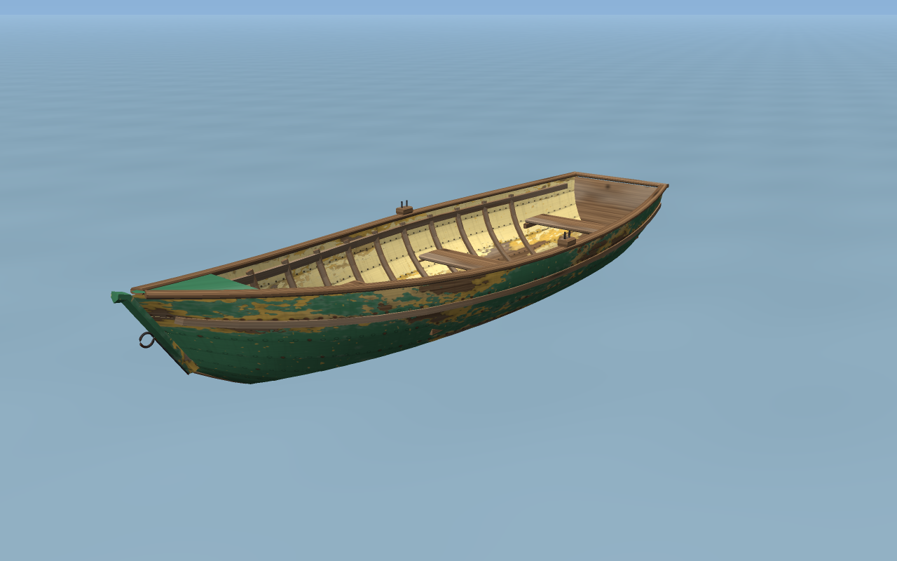

# Seerose – a retro clinker lake boat for Second Life

A small wooden rowing boat of the kind you find on European lakes: clinker (lapped) planking,
pointed stem, flat raked transom, three thwarts, steam-bent ribs, floorboards, oak gunwale and
rubbing strake, iron stem band and bow ring, rowlocks. Painted green; the paint has flaked off in
patches to show **old yellow paint, and in the worst spots bare brown wood**. The transom carries
the boat's name, also half worn away.

Size: **4.44 m × 1.39 m × 0.83 m** (bow = +X). Built entirely from code (numpy + PIL), no Blender.



## What's here

| Path | What |
|---|---|
| `out/mesh/lakeboat_LOD3.dae` … `LOD0.dae` | Visual mesh, 4 levels of detail (8.6k / 5.0k / 1.9k / 1.3k triangles) |
| `out/mesh/lakeboat_physics.dae` | Physics shape (110 triangles, closed hull up to the floorboards) |
| `out/mesh/lakeboat.obj` (+`.mtl`) | Same high-LOD mesh as OBJ, for Blender or any viewer |
| `out/textures/*_d.png` | Diffuse maps |
| `out/textures/*_n.png` | Normal maps (alpha = 0, i.e. no environment reflection) |
| `out/textures/*_s.png` | Specular maps (alpha = glossiness) |
| `lakeboat_drive.lsl` | Vehicle script: sit on the rowing thwart, row, steer, wake and optional sound |
| `out/preview/*.png` | Renders from my own small software renderer (not Second Life, see "Honest limits") |

## Faces (materials)

Every LOD has the same 5 faces **in this order**; face numbers in the SL build tool follow it.

| Face | Material | Parts | Texture (size) |
|---|---|---|---|
| 0 | `hull_planks` | outer planking, keel board | `hull` (1024²) |
| 1 | `interior` | inner planking | `interior` (1024²) |
| 2 | `hull_end` | transom, stem post, bow deck | `hull_end` (512²) |
| 3 | `wood` | gunwale, benches, ribs, floor, keel strip, rowlock blocks | `wood` (512²) |
| 4 | `metal` | rowlock horns, stem band, bow ring | `metal` (128²) |

## Getting it into Second Life

1. **Build ▸ Upload ▸ Model**, pick `lakeboat_LOD3.dae` as the high-LOD model.
2. *Level of Detail* tab: for Medium / Low / Lowest choose **Load from file** → `LOD2`, `LOD1`, `LOD0`.
3. *Physics* tab: **Load from file** → `lakeboat_physics.dae`. (It is a solid slab up to the
   floorboards, so avatars can stand inside the boat.)
4. Leave scale at 1.0 (the files are already in metres) and untick **Include textures**.
   Check the weights/land-impact figure the uploader shows. If it is too high, tell me and I'll
   cut triangles.
5. **Build ▸ Upload ▸ Image** for the five `*_d.png` (and, if you want the extra depth, the
   `*_n.png` / `*_s.png` for hull, interior, hull_end and wood).
6. Rez the boat, open *Edit ▸ Texture*, select each face (0–4, table above), apply the diffuse
   texture, then use the *Materials* radio button to add normal and specular maps.
7. *Edit ▸ Features*: Physics shape type **Prim** (= use the uploaded physics shape).
8. Make a new script in the boat and paste `lakeboat_drive.lsl`.

The boat is not physical until someone sits; the script switches physics on and off.
Keys: W/S row forward/back, A/D steer. If the pilot sits too high or low, the owner can nudge the
seat with `/77 up`, `/77 down`, `/77 fwd`, `/77 back`, `/77 left`, `/77 right`, then stand and
re-sit. The script prints the new `SIT_POS` to paste back into the constants at the top.

## Honest limits

- **Nothing here has been run inside Second Life.** I can't log in. The COLLADA files were
  checked with an independent parser (pycollada: Z-up, metres, 5 faces, one shared vertex
  pool, UVs in 0–1, unit normals, matching bounding boxes across all LODs), the physics hull
  is watertight with consistent winding, and the previews are rendered from the same files and
  textures. But the SL uploader, the land-impact number, and especially the **vehicle feel**
  (hover height, how it grips the water, turning) still need an in-world test. Those constants
  are marked `TUNE` in the script.
- The `.lsl` script passes a full LSL parser and type check (LSL-PyOptimizer, via the repo's
  `tools/lslcheck.sh`; roughly 40 KB of Mono memory free), so it should compile in-world. That
  says nothing about how the boat *drives*; see the `TUNE` values.
- The sit position is an estimate from the thwart height; use the nudge commands.
- The previews are not SL lighting. The paint will look different under SL's sun and with
  normal/specular maps on.

## Rebuilding / changing it

Everything is generated; change a number and re-run.

```
pip install numpy pillow            # pycollada + trimesh only if you want to validate
python3 make_textures.py            # paint → out/textures
python3 export.py                   # mesh   → out/mesh (all LODs, physics, OBJ)
python3 preview.py                  # renders → out/preview  (LOD=2 / FAST=1 / NOWATER=1 optional)
```

- `boat.py` – hull shape (`LEN0`, `BMAX`, `KP`, `ZP`, sheer and rake functions), strake count,
  lap depth (`DELTA`), thwart positions, ribs, rowlocks and the LOD budgets (`LODS`).
- `make_textures.py` – paint colours (`GREEN`, `YELLOW`, `WOOD_*`), how much paint has flaked
  (`cov_top` = share of green lost, `cov_mid` = share where the yellow is gone too), the boat name.
- `layout.py` – the texture-atlas layout shared by mesh and textures.
- `lakeboat_drive.lsl` – speeds, turn rate, hover height, camera, sound name.

Ideas for next steps: oars (separate object so they can animate), a small outboard or a
sail, passenger seats, a mooring rope, a second paint job (blue, or freshly painted).
