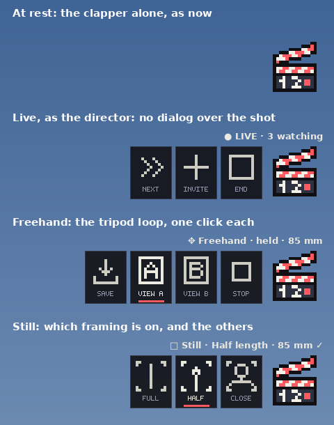

# Soft keys (concept; built in 6.5 as `hud/src/keys.lsl`)

Chosen: one strip prim, the three moments below (Live, Freehand, Still), plus the viewer's NEXT · ASK · LEAVE. The real texture is `hud/art/take12_keys_512x1024.png` (`tools/art/make_keys.py`). This folder keeps the concept and its first mockup.

**The idea.** At rest, Take 12 stays one clapper. In a few busy moments, and only then, up to five quiet keys appear beside it. They fold away after a few seconds, or when that moment ends. Everything else stays in the dialog menus.

**The rule for a key.** It replaces a 2–3 click menu path at a moment when you are busy and a dialog over the shot gets in the way. Framing, the camera list, Frame formats, Options and Help do not qualify: the menu does them well, and trying them costs nothing.

## Candidate moments (to choose from)
| Moment | Keys | Why |
|---|---|---|
| **Live, as the director** | Next · Invite · End | You are hosting. The Share dialog over everyone's shot is the clumsiest moment in the HUD, and Next is the action you repeat. |
| **Freehand** | Save · View A · View B · Stop | The tripod loop: save a view, try another, go back. A double-tap recalls views blind today. |
| **Still** | Full · Half · Close | Shows which framing is on; a double-tap cycles them blind today. |

## Style
- Thin 1-pixel line icons in chalk on a near-black key: no figures, no fills, no colour.
- A small-caps label in the HUD's pixel font.
- The key in use gets a coral underline, the one accent.
- The status line above the button stays as it is.

## Building it (if chosen)
- One icon atlas texture; the keys are linked prims after the four Frame bars (links 6 and up).
- Touches are routed by link number (ui already ignores links above 1).
- Most likely a small script of its own: ui has little memory left.

## Open questions
1. Which moments, if any?
2. Labels under the icons, or icons only?
3. A row to the left of the button (as drawn), or a column below it?

Redraw the mockup with `python3 legacy/old-lab/softkeys/make_mockup.py`.
